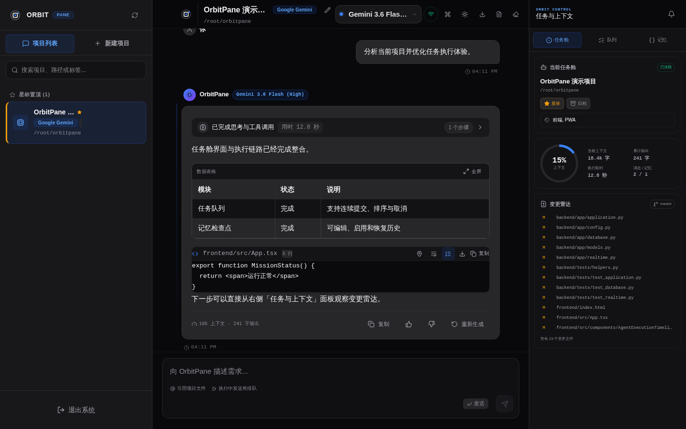
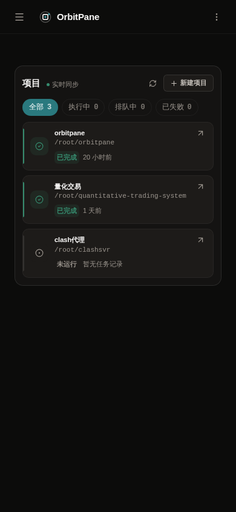

<div align="center">
  
  <h1>OrbitPane</h1>
  <p><strong>把服务器上的编程 Agent，装进随时可用的工作台。</strong></p>
  <p>自托管 · 实时对话 · 任务队列 · 定时执行 · 桌面与移动端 PWA</p>
  <p>
    
    
    
    
  </p>
  <p>
    <a href="#项目截图">项目截图</a> ·
    <a href="#快速开始">快速开始</a> ·
    <a href="#部署">部署</a> ·
    <a href="docs/operations.md">详细文档</a> ·
    <a href="https://github.com/imhzy/orbitpane/issues">反馈问题</a>
  </p>
</div>

OrbitPane 是一个面向个人使用的自托管编程 Agent 工作台。通过浏览器连接服务器上的项目，发送任务、查看执行过程、管理上下文，并在手机上继续跟进进度。对话、任务记录和项目设置保存在自己的服务器上；模型请求由所配置的 Agent 服务处理。

默认接入 **Antigravity**，可选启用 **Codex CLI**。不同 Agent 共用同一套项目管理、权限控制和实时交互界面。

## 项目截图

### 桌面工作台

项目列表、对话与执行时间线、任务及上下文面板集中展示。



### 移动端任务中心

在手机上查看项目状态，也可以将 PWA 添加到主屏幕。

<p align="center">
  
</p>

> 截图来自仓库现有的 PWA 展示素材，界面和模型名称以实际运行版本为准。

## 核心功能

| 功能 | 说明 |
| --- | --- |
| 多项目工作台 | 项目置顶、归档、模型偏好、草稿保存和历史全文搜索 |
| 实时执行 | 流式回复、执行时间线、任务状态与耗时，支持断线重连 |
| 任务队列 | 同一会话串行执行，排队任务可编辑、排序和取消；不同会话可并行 |
| 上下文管理 | 在对话中生成可折叠的摘要检查点，同时保留原始历史 |
| 定时任务 | 支持间隔、每日、每周和时区设置，浏览器关闭后仍由后端调度 |
| 多 Agent 接入 | 默认 Antigravity，可选 Codex，统一的 provider 接口便于扩展 |
| PWA 与通知 | 桌面、移动端适配；可选 Web Push，在任务完成后接收通知 |
| 通行密钥 | PIN 登录与可选 Passkey，支持兼容设备上的 Face ID / Touch ID |
| 对话分享 | 创建只读快照，设置有效期、复制或撤销链接，不包含工作区元数据 |
| 访问控制 | HttpOnly 会话 Cookie、工作区目录白名单，默认使用受限 Agent 权限 |

## 快速开始

### 环境要求

- Python **3.11+**
- Node.js **20.19+ 或 22.12+**，以及 npm
- 已安装并完成认证的 `antigravity` CLI；使用 Codex 时需准备对应 CLI
- 生产部署使用 Linux、Nginx 与 PM2

### 1. 获取代码并安装依赖

```bash
git clone https://github.com/imhzy/orbitpane.git
cd orbitpane

python3 -m venv ~/.venvs/orbitpane
source ~/.venvs/orbitpane/bin/activate
python3 -m pip install -e '.[test]'

cd frontend
npm ci
cd ..
```

### 2. 配置本地环境

```bash
cp .env.example .env
openssl rand -hex 32
```

编辑 `.env`，将上一步生成的随机值填入 `ORBITPANE_AUTH_SECRET`，并按本机目录修改配置：

```dotenv
ORBITPANE_ENV=development
ORBITPANE_HOST=127.0.0.1
ORBITPANE_PORT=8005
ORBITPANE_PIN=replace-with-your-private-pin
ORBITPANE_AUTH_SECRET=replace-with-your-generated-secret
ORBITPANE_DATABASE_PATH=/absolute/path/to/orbitpane/history.db
ORBITPANE_ALLOWED_ROOTS=/absolute/path/to/your/projects
ORBITPANE_WEBAUTHN_ORIGIN=http://localhost:5173
```

工作区目录需要预先存在。后端自动读取仓库根目录的 `.env`，已设置的环境变量优先；不要提交真实凭据。完整配置见 [`.env.example`](.env.example)。

### 3. 启动服务

在已激活 Python 虚拟环境的终端启动后端：

```bash
python3 backend/main.py
```

另开一个终端启动前端：

```bash
cd frontend
npm run dev
```

打开 **http://localhost:5173**，使用配置的 PIN 登录，然后选择白名单内的目录新建项目。Vite 已将 `/api` 和 WebSocket 请求代理至本地 `8005` 端口。

### 4. 可选：启用 Codex

在 `.env` 中设置以下值，然后重启后端：

```dotenv
CODEX_ENABLED=true
CODEX_SANDBOX=workspace-write
CODEX_REASONING_SUMMARY=detailed
```

启用后可在创建项目时选择 Codex。模型发现、推理强度和运行中恢复机制见 [Agent 配置](docs/operations.md#optional-codex-provider)。

## 部署

1. 在服务器完成依赖安装，将 `.env` 中的 `ORBITPANE_ENV` 改为 `production`，配置独立的 PIN、随机签名密钥和工作区白名单。
2. 在 `frontend/` 下运行 `npm ci && npm run build`，生成 `frontend/dist`。
3. 从仓库根目录启动后端，解释器应指向安装了依赖的虚拟环境：

   ```bash
   pm2 start backend/main.py --name orbitpane-backend --interpreter "$HOME/.venvs/orbitpane/bin/python"
   pm2 save
   ```

4. 以 [`deploy/nginx/`](deploy/nginx/) 为配置来源，修改域名、证书路径和前端静态目录；检查配置后加载 Nginx，并通过 HTTPS 访问。

后端保持监听 `127.0.0.1:8005`，由 Nginx 代理 API 和 WebSocket。使用 **单个后端进程**，因为执行队列和调度器属于该进程。代理配置中的分享链接日志脱敏、安全响应头及 `/s/` 路由规则需要保留。

生产环境使用 Passkey 时，将 `ORBITPANE_WEBAUTHN_ORIGIN` 设置为实际 HTTPS 来源。Web Push 需要额外生成 VAPID 密钥，操作见下方文档。

## 文档

| 主题 | 内容 |
| --- | --- |
| [配置参考](docs/operations.md#configuration) | 环境变量、认证、工作区与跨域配置 |
| [定时任务](docs/operations.md#scheduled-agent-commands) | 调度规则、时区、队列、重启与取消语义 |
| [推送通知](docs/operations.md#task-completion-push-notifications) | VAPID 配置、iOS 主屏幕安装和消息投递 |
| [通行密钥](docs/operations.md#passkey-login-ios-and-other-supported-devices) | Passkey 绑定、登录与恢复 |
| [Agent 配置](docs/operations.md#optional-codex-provider) | Codex 启用、模型发现与恢复策略 |
| [对话分享](docs/operations.md#conversation-sharing) | 快照、有效期、撤销与数据清理 |
| [生产运维](docs/operations.md#production) | 构建、PM2 与 Nginx 部署 |

## 项目结构

```text
orbitpane/
├── backend/
│   ├── app/
│   │   ├── application.py  # HTTP / WebSocket 入口
│   │   ├── database.py     # SQLite 持久化
│   │   ├── realtime.py     # 实时连接与执行队列
│   │   ├── scheduler.py    # 定时任务调度
│   │   └── agents/         # AgentProvider 与具体适配器
│   └── tests/             # 后端回归测试
├── frontend/
│   ├── src/               # React 界面与统一 API 客户端
│   └── public/            # PWA 资源与项目截图
├── deploy/nginx/          # 反向代理与安全配置
└── docs/                  # 使用与运维文档
```

前端通过经过认证的 REST 与 WebSocket 连接 FastAPI，后端将数据存储在 SQLite，并通过 `AgentProvider` 调用 CLI。新增 Agent 应实现统一接口，避免在传输层或前端协议中加入 provider 特判。

## 开发与贡献

欢迎通过 [Issues](https://github.com/imhzy/orbitpane/issues) 提交可复现的问题或功能建议，也欢迎提交 Pull Request。修改前请阅读 [仓库开发约定](AGENTS.md)，保持改动聚焦，并为行为变化补充相应验证。

提交前运行：

```bash
python3 -m unittest discover -s backend/tests -v
python3 -m compileall -q backend
cd frontend
npm run lint
npm run build
```

涉及推送通知时，另运行 `node --test frontend/tests/push-worker.test.mjs`（从仓库根目录执行）。

## 安全与数据

OrbitPane 面向单所有者工作区。Agent 能修改文件并运行工具，请为服务配置与信任范围匹配的系统账号、容器或虚拟机，限制工作区目录，并保持默认受限权限。

分享链接的持有者可以读取对应快照；分享前请检查对话内容。清空历史或删除会话会删除对应分享快照。备份时妥善保管数据库与 `.env`，不要在 Issue、日志或截图中公开凭据和分享令牌。更多细节见 [安全说明](docs/operations.md#security-notes)。

## 许可证

仓库目前尚未提供 `LICENSE` 文件。使用、修改或分发前，请与维护者确认授权范围。
